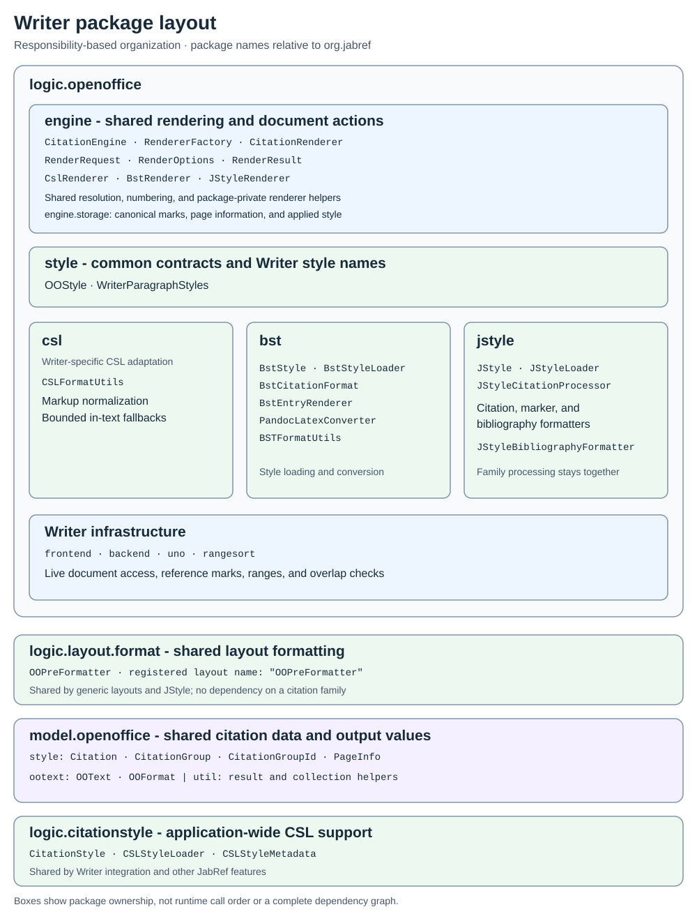

# Code reorganization

Why

<<<<<<< HEAD
* Separate backend
* Separate GUI code (dialogs) and logic
* Data is now organized around `Citation`, `CitationGroup` instead of arrays for citation group fields, and arrays of arrays for citation fields.\
  Also take `citationKey` as the central data unit, this is what we start with: unresolved `citationKeys` do not stop processing. Although we cannot sort them by author and year, we can still emit a marker that acts as a placeholder and shows the user the problematic key.
=======

>>>>>>> ecb8ff76cb (OpenOffice Backend re-architecture B - Package reorganization (#17918))

## Result

### Layers

<<<<<<< HEAD

### By directories
=======
| Package | Responsibility | Principal types |
| --- | --- | --- |
| `gui.openoffice` in `jabgui` | Present document actions, select styles, and show results. | `OpenOfficePanel`, `OpenOfficeCitationController`, `OpenOfficeDocumentConnection`, `CslStyleResolver` |
| `logic.openoffice` | Shared citation identities, preferences, and Zotero protocol support. | `CitationIds`, `CitedEntryCollector`, `OpenOfficePreferences`, `ZoteroReferenceMark`, `ZoteroCitationLinker`, `ZoteroDocumentPreferences` |
| `logic.openoffice.engine` | Coordinate document actions and compute renderer output. | `CitationEngine`, `UpdatePipeline`, `CitationGroupEditor`, `CitationFormatConverter`, `DocumentWriteSession`, `CitationRenderer` |
| `logic.openoffice.engine.storage` | Read canonical citations and apply prepared text/property changes. | `MarkStore`, `CitationMarkerWriter`, `DocumentStyleStore`, `UndoableDocumentProperties` |
| `logic.openoffice.frontend` | Combine the live document with the citation model, ordering, and overlap protection. | `DocumentCitations`, `DocumentOrder`, `RangeForOverlapCheck` |
| `logic.openoffice.backend` | Work with concrete Writer reference-mark ranges without interpreting citation names. | `WriterReferenceMark`, `WriterReferenceMarks`, `ReferenceMarkTextWriter`, `WriterTextContext` |
| `logic.openoffice.uno` | Access Writer services, interfaces, cursors, named content, and properties. | `UnoInterfaces`, `NamedTextContentInserter`, `NamedTextContentPlacement`, `NamedTextContentLookup`, `OOTextWriter` |
| `logic.openoffice.rangesort` | Order UNO ranges and detect overlaps. | `RangeSort`, `RangeSortVisual`, `RestorableTextViewCursor`, `WithinSetRangeOverlapFinder`, `BetweenSetsRangeOverlapFinder` |
| `logic.openoffice.style` | Define the common selectable-style contract and family-neutral Writer style names. | `OOStyle`, `WriterParagraphStyles` |
| `logic.openoffice.jstyle` | Load JStyles and compute JStyle-specific citation and bibliography formatting. | `JStyle`, `JStyleLoader`, `JStyleCitationProcessor`, `JStyleBibliographyFormatter` |
| `logic.openoffice.bst` | Load Writer BST styles, select citation notation, and convert BST output through Pandoc. | `BstStyle`, `BstStyleLoader`, `BstCitationFormat`, `BstEntryRenderer`, `PandocLatexConverter`, `BSTFormatUtils` |
| `logic.openoffice.csl` | Adapt CSL output to Writer-ready text. | `CSLFormatUtils` |
| `model.openoffice.style` | Represent citations, groups, resolved sources, and presentation state without UNO access. | `Citation`, `CitationGroup`, `CitationGroupId`, `CitationGroups`, `CitedReference`, `CitedReferences` |
| `model.openoffice.ootext` | Describe formatted output independently of Writer. | `OOText`, `OOFormat` |
| `model.openoffice.util` | Supply result types and collection helpers used across the integration. | `OOResult`, `OOVoidResult`, `OOListUtil` |

Writer-specific family helpers are grouped in `jstyle`, `bst`, and `csl`; `style` contains common contracts and Writer paragraph-style identifiers.
`WriterParagraphStyles` owns the neutral catalogs; CSL-aware default selection stays in `CSLFormatUtils`.
`OOPreFormatter` belongs to `logic.layout.format`, shared by generic layouts and JStyle without depending on a citation family.
Shared CSL style loading and metadata remain in `logic.citationstyle`, including `CitationStyle`, `CSLStyleLoader`, and `CSLStyleMetadata`.
The `backend` package is concrete Writer infrastructure, not a family-specific citation backend interface.
UNO access and range sorting belong to `logic`, not to the pure model packages.
`JStyle` and `BstStyle` also belong in `logic`: they load and parse definitions and hold executable layouts or BST programs.
`OOStyle` describes the selection contract for those logic implementations, while citation identities, groups, page information, and formatted-output values belong in `model`.
>>>>>>> ecb8ff76cb (OpenOffice Backend re-architecture B - Package reorganization (#17918))

* `model`
  * `util` : general utilities
    * (`OOPair`, `OOTuple3`) collect two or three objects without creating a new class
    * `OOResult` : while an Optional.empty can comunicate failure, it cannot provide details.\
      `OOResult` allows an arbitrary error object to be provided in case of failure.
    * `OOVoidResult` : for functions returning no result on success, only diagnostics on failure.
    * `OOListUtil`: some utilities working on List
  * `uno` : helpers for various tasks via UNO.\
    These are conceptually independent of JabRef code and logic.
  * `ootext` : to separate decisions on the format of references and citation marks from the actual insertion into the document, the earlier method `OOUtil.insertOOFormattedTextAtCurrentLocation` was extended to handle new tags that describe actions earlier done in code.
    * This became `OOTextIntoOO.write`
      * `(change)` Now all output to the document goes through this, not only those from Layout. This allows the citation markers and `jstyle:Title` to use these tags.
        * This allows some backward-compatible extensions to jstyle.\
          `(change)` Added some extra keywords, in `{prefix}_MARKUP_BEFORE`, `{prefix}_MARKUP_AFTER` pairs to allow bracketing some parts of citation marks with text and/or open/close tag pairs.
    * `OOFormat` contains helpers to create the appropriate tags
    * `OOText` formalizes the distinction from `String`. I did not change `String` to `OOText` in old code, (in particular in OOStyle).
  * `rangesort` : ordering objects that have an `XTextRange`, optionally with an extra integer to break ties.
    * `RangeSort.partitionAndSortRanges` : since `XTextRangeCompare` can only compare `XTextRange` values in the same `XText`, we partition them accordingly and only sort within each partition.
    * `RangeSortable` (interface), `RangeSortEntry` (implements) :\
      When we replace `XTextRange` of citation marks in footnotes with the range of the footnote mark, multiple citation marks may be mapped to the same location. To preserve the order between these, `RangeSortable` allows this order to be indicated by returning appropriate indices from `getIndexInPosition`
    * `RangeSortVisual` : sort in top-to-bottom left-to-right order.\
      Needs a functional `XTextViewCursor`.\
      Works on `RangeSortable` values.
    * `FunctionalTextViewCursor` : helper to get a functional `XTextViewCursor` (cannot always)
    * `RangeOverlapWithin` : check for overlaps within a set of `XTextRange` values. Probably O(n\*log(n)). Used for all-to-all check of protected ranges.
    * `RangeOverlapBetween` : check for overlaps between two sets of `XTextRange` values. Assumes one set is small. O(n\*k). Used for checking if the cursor is in a protected range.
  * `backend` : interfaces to be provided by backends.\
    May change as new backends may need different APIs.
  * `style` : data structures and interfaces used while going from ordered list of citation groups to formatted citation markers and bibliography. Does not communicate with the document. Too long to fit here, starting a new section.

## model/style

At the core,

* we have `Citation` values
  * represented in the document by their `citationKey`
  * each may have a `pageInfo`
* A citation group (`CitationGroup`) has
  * a list of citations (`citationsInStorageOrder`)
  * an identifier `CitationGroupId cgid`
    * this allows to refer to the group
    * also used to associate the group to its citation markers location (outside the style part, in `Backend52`)
  * `OODataModel dataModel` is here, in order to handle old (Jabref5.2) structure where pageInfo belonged to CitationGroup not Citation
  * `referenceMarkNameForLinking` is optional: can be used to crosslink to the citation marker from the bibliography.
* `CitationGroups` represents the collection of citation groups.\
  Processing starts with creating a `CitationGroups` instance from the data stored in the document.
* `CitedReference` represents a cited source, with ordered back references (using `CitationPath`) to the corresponding citations.
* `CitedReferences` is just an order-preserving collection of `CitedReference` values that also supports lookup by `citationKey`. While producing citation markers, we also create a corresponding `CitedReferences` instance, and store it in `CitationGroups.bibliography`. This is already sorted, its entries have `uniqueLetter` or `number` assigned, but not converted to markup yet.

Common processing steps:

* We need `globalOrder` for the citation groups (provided externally) `CitationGroups.setGlobalOrder()`
* We need to look up each citationKey in the bibliography databases:
  * `CitationGroups.lookupCitations` collects the cited keys, looks up each, then distributes the results to the citations. Uses a temporary `CitedReferences` instance, based on unsorted citations and citation groups.
* `CitationGroups.imposeLocalOrder` fills `localOrder` in each `CitationGroup`
* Now we have order of appearance for the citations (`globalOrder` and `localOrder`).\
  We can create a `CitedReferences` instance (`bibliography`) according to this order.
* For citations numbered in order of first appearance we number the sources and distribute the numbers to the corresponding citations.
* For citations numbered in order of bibliography, we sort the bibliography, number, distribute.
* For author-year citations we have to decide on the letters `uniqueLetter` used to distinguish sources. This needs order of first appearance of the sources and recognizing clashing citation markers. This is done in logic, in `OOProcessAuthorYearMarkers.createUniqueLetters()`
* We also mark first appearance of each source (`setIsFirstAppearanceOfSourceInCitations`)

The entry point for this processing is: `OOProcess.produceCitationMarkers`.

It fills

<<<<<<< HEAD
* each `CitationGroup.citationMarker`
* `CitationGroups.bibliography`
  * From bibliography `OOFormatBibliography.formatBibliography()` creates an `OOText` ready to be written to the document.
=======
`RendererFactory` selects `JStyleRenderer`, `CslRenderer`, or `BstRenderer` through `CitationRenderer`.
A `RenderRequest` supplies groups in document order, libraries, and options; `RenderResult` contains formatted markers, requested bibliography paragraphs, and unresolved keys.
`CitationKeyResolution` resolves keys using the request's library precedence and prepares resolved entry data without treating entry IDs as citation keys.
`CitationNumbering` supplies shared numbering operations; each renderer applies its style-family ordering and label rules.
Renderers compute output without writing to Writer.
All three renderers and the package-private `BstCitationFormatter` remain in `logic.openoffice.engine`, alongside the render/action boundary.
This keeps `CitationKeyResolution`, `BibliographyText`, and native CSL rendering internal to the engine rather than exposing them to family helper packages.
>>>>>>> ecb8ff76cb (OpenOffice Backend re-architecture B - Package reorganization (#17918))

## logic/style

* `StyleLoader` : not changed (knows about default styles) Used by GUI
* `OOPreFormatter` : LaTeX code to unicode and OOText tags. (not changed)
* `OOBibStyle` : is mostly concerned by loading/parsing jstyle files and presenting its pieces to the rest. Originally it also contains code to format numeric and author-year citation markers.
  * Details of their new implementations are in `OOBibStyleGetNumCitationMarker` and `OOBibStyleGetCitationMarker`
  * The new implementations
    * support pageInfo for each citation
    * support unresolved citations
    * instead of `List<Integer>` and (`List<BibEntry>` plus arrays and database) they expect more self-contained entries `List<CitationMarkerNumericEntry>`, `List<CitationMarkerEntry>`.
    * We have distinct methods for `getNormalizedCitationMarker(CitationMarkerNormEntry)` and `getNumCitationMarkerForBibliography(CitationMarkerNumericBibEntry)`.
    * The corresponding interfaces in model/style:
      * `CitationMarkerNumericEntry`
      * `CitationMarkerEntry`
      * `CitationMarkerNumericBibEntry`
      * `CitationMarkerNormEntry`\
        describe their expected input entries.
* `OOProcess.produceCitationMarkers` is the main entry point for style application. Calls to specific implementations in `OOProcessCitationKeyMarkers`, `OOProcessNumericMarkers` and `OOProcessAuthorYearMarkers` according to jstyle flags.

## logic/backend

Details of encoding and retrieving data stored in a document as well as the citation maker locations. Also contains dataModel-dependent code (which could probably be moved out once the datamodel is settled).

Creating and finding the bibliography (providing a cursor to write at) should be here too.\
These are currently in `UpdateBibliography`

## logic/frontend

* `OOFrontend` : has a `Backend` and `CitationGroups`
  * Its constructor creates a backend, reads data from the document and creates a CitationGroups instance.
  * provides functionality that requires both access to the document and the CitationGroups instance
* `RangeForOverlapCheck` used in `OOFrontend`
* `UpdateBibliography` : Create, find and update the bibliography in the document using output from `produceCitationMarkers()`
* `UpdateCitationMarkers` create `CitationGroup`, update citation markers using output from `produceCitationMarkers()`

## logic/action

GUI-independent part of implementations of GUI actions.

## gui

<<<<<<< HEAD
* `OOError` : common error messages and dialog titles
  * adds `title` to `Jabrefexception`
  * converts from some common exception types using type-specific message
  * contains some dialog messages that do not correspond to exceptions
* `OOBibBase2` : most activity was moved out from here to parts discussed above.
  * connecting / selecting a document moved to `OOBibBaseConnect`
  * the rest connects higher parts of the GUI to actions in logic
    * does argument and precondition checking
    * catches all exceptions
    * shows error and warning dialogs
    * adds `enterUndoContext`, `leaveUndoContext` around action code
=======
`JStyle` exposes the formatting entry points:

- `formatNumericCitation(...)` delegates to `JStyleNumericCitationFormatter`, including numeric-range formatting and page information.
- `getNumCitationMarkerForBibliography(...)` delegates numeric bibliography labels to the same formatter.
- `createCitationMarker(...)` and `getNormalizedCitationMarker(...)` delegate author-year and partial-type formatting to `JStyleCitationFormatter`.

`JStyleRenderer` invokes the processor and uses `JStyleBibliographyFormatter.formatBibliographyEntry` for requested bibliography paragraphs before returning a `RenderResult`.
JStyle bibliography paragraph styles are validated only when bibliography output is requested.
The JStyle processors, formatters, and loaders live in `logic.openoffice.jstyle`.
They use `logic.layout.format.OOPreFormatter` to convert LaTeX to Unicode and `OOText` tags for layout output; its registered layout name remains `OOPreFormatter`.
`OOText` and `OOFormat` describe that output without depending on logic implementations; only the logic-layer `OOTextWriter` interprets it into Writer text.

`OOStyle` in `logic.openoffice.style` is the common selectable-style interface for `JStyle`, `CitationStyle`, and `BstStyle`.
`BstStyle`, `BstStyleLoader`, and `BstCitationFormat` live with the Pandoc conversion helpers in `logic.openoffice.bst`.
`BstStyle.getBstVM()` exposes its cached parsed program rather than creating a new VM.
BST whole-cited-set rendering and citation labels belong to `BstRenderer` and `BstCitationFormatter` in `logic.openoffice.engine`.
BST supports `NORMAL` and `IN_TEXT` for all three notations: `NUMERIC`, `AUTHOR_YEAR`, and `STYLE_DEFINED`.
In-text groups preserve storage order, pairing each source's Natbib-formatted short author list with its number, year, or style-defined label; repeated sources and unresolved placeholders retain their positions.
For both normal and in-text groups, `AUTHOR_YEAR` without requested bibliography output skips BST source loading, VM execution, and Pandoc; numeric and style-defined notations still require BST execution for numbering, labels, and ordering.
`CSLFormatUtils` in `logic.openoffice.csl` adapts CSL-generated markup rather than selecting a renderer or managing document citations.

## Writer infrastructure and ordering

`WriterReferenceMarks` creates and locates Writer marks without parsing their citation identities.
`WriterReferenceMark` and `ReferenceMarkTextWriter` handle range boundaries and text replacement; `WriterTextContext` reads surrounding text for citation management.
Canonical marks use persistent invisible boundaries, while native Zotero marks use temporary boundaries removed only when safe.

The UNO package separates named-content operations:

- `NamedTextContentPlacement` describes the document, name, range, and absorption choice for insertion.
- `NamedTextContentInserter` creates and inserts named Writer content such as reference marks, bookmarks, and sections.
- `NamedTextContentLookup` finds named content supporting `XTextContent`.
- `UnoInterfaces.query` obtains an optional UNO interface through `UnoRuntime.queryInterface`; it is not a Java cast.

`WriterOperationException` reports failures performing Writer operations, including service or named-content creation.
`WriterDocumentAccessException` reports unavailable document or citation-range access.
Other `Uno*` helpers provide cursor, text-section, property, redline, undo, and controller access; they do not choose citation styles.

`DocumentOrder` coordinates citation-level ordering.
`RangeSort` compares ranges within compatible text containers, while `RangeSortVisual` uses view-cursor coordinates.
`RestorableTextViewCursor` obtains a usable view cursor and supports restoring its earlier position or selection.
`WithinSetRangeOverlapFinder` detects overlaps within one range set; `BetweenSetsRangeOverlapFinder` checks between sets.
`RangeForOverlapCheck` carries a protected range, its identity, and a description for overlap diagnostics.
See the [ordering guide](order-of-appearance.md) for footnote mapping, merge adjacency, textual fallback, and visual-layout limitations.

## Tests and further reading

Unit tests mirror the GUI, engine, storage, style-family helpers, and Writer infrastructure packages.
Under `jablib/src/test/java/org/jabref/logic/openoffice/`, `JStyle*` tests are in `jstyle`, `BstStyle*` tests are in `bst`, and `CSLFormatUtilsTest` is in `csl`.
`OOPreFormatterTest` mirrors its shared formatter under `logic/layout/format/`; model markup tests remain under `model/openoffice/ootext/`.
Package-relative JStyle fixtures live in `jablib/src/test/resources/org/jabref/logic/openoffice/jstyle/`; absolute built-in `/resource/openoffice/` paths are unchanged.
`JabRefMarkCodecTest` checks the canonical codec; `JabRefMarkCodecCompatibilityTest` checks its storage boundary against legacy names.
`BstCitationFormatterTest` exercises BST label/marker helpers, and `NonUndoableStylePropertiesTest` documents the ordinary style-property undo boundary.
`JStyleTestHelper` supports JStyle formatting tests; `JabRefCliPreferencesTest` checks preference serialization and style persistence.

Real-Writer acceptance tests live in `jablib/src/test/java/org/jabref/logic/openoffice/integration/`, with storage acceptance coverage in `engine/storage`.
The [testing guide](../testing.md#libreoffice-writer-integration-tests) describes the safety gate, minimum invocation counts, and saved artifacts.
Fixture details are in the [fixture README](https://github.com/JabRef/jabref/blob/main/jablib/src/test/resources/org/jabref/logic/openoffice/integration/README.md).
For older design evidence, see the [historical problems page](problems.md).
For repository orientation, see [JabRef on DeepWiki](https://deepwiki.com/JabRef/jabref).
>>>>>>> ecb8ff76cb (OpenOffice Backend re-architecture B - Package reorganization (#17918))
